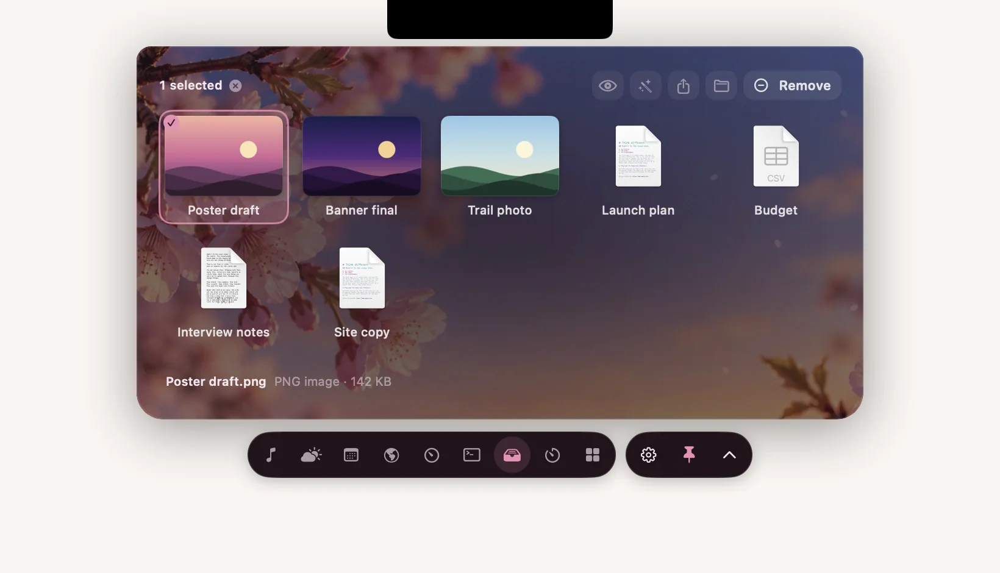
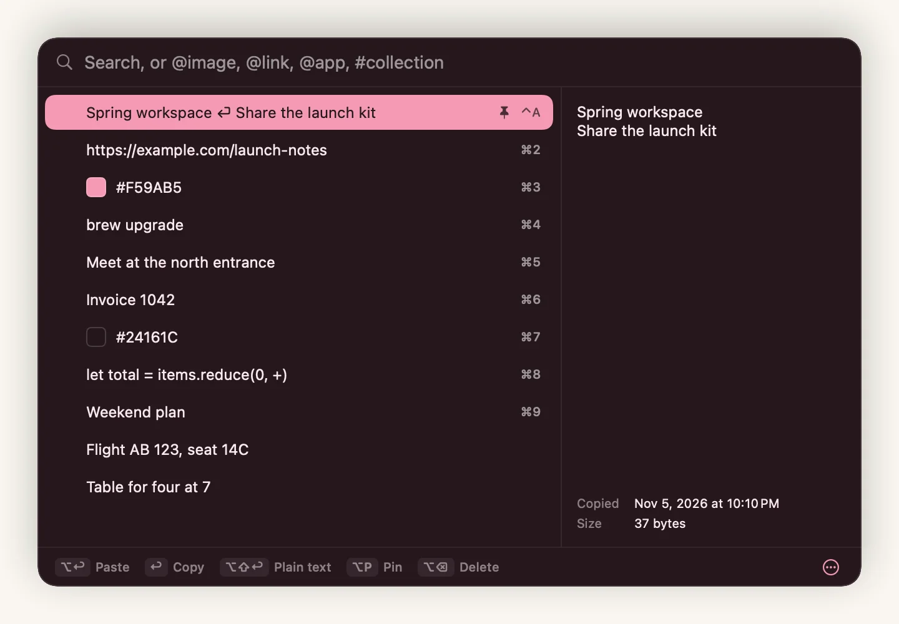
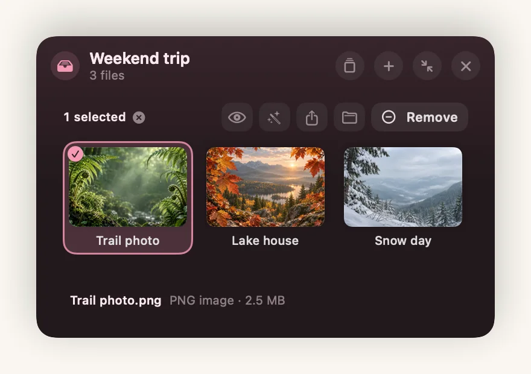

<div align="center">

# MacSpaces

**MacSpaces turns your notch into a workstation.**

[](https://github.com/zlichtman/MacSpaces/releases/latest)
[](#install)
[](#install)
[](#install)
[](#install)
[](LICENSE)

[Website](https://www.zlichtman.com/macspaces) · [Download](https://github.com/zlichtman/MacSpaces/releases/latest/download/MacSpaces.dmg)


</div>

Hover the notch to open your workspace. Free, open source, on any Mac.

## Install

[Download MacSpaces.dmg](https://github.com/zlichtman/MacSpaces/releases/latest/download/MacSpaces.dmg), or:

```sh
brew install --cask zlichtman/tap/macspaces
```

## Pages

<table>
<tr>
<td width="50%"><br><b>Music</b>: lyrics, Shelf, backups</td>
<td width="50%"><br><b>Calendar</b>: your month and day</td>
</tr>
<tr>
<td><br><b>Agents</b>: Claude Code and Codex</td>
<td><br><b>Usage</b>: tokens and limits</td>
</tr>
<tr>
<td><br><b>Weather</b></td>
<td><br><b>Clock</b>: your places on a globe</td>
</tr>
<tr>
<td><br><b>Timers</b>: can pause your music</td>
<td><br><b>Meetings</b>: mute and camera</td>
</tr>
<tr>
<td><br><b>Dictation</b></td>
<td><br><b>Teleprompter</b>: hidden when sharing</td>
</tr>
<tr>
<td><br><b>Shortcuts</b></td>
<td><br><b>Notes</b></td>
</tr>
<tr>
<td><br><b>System</b>: battery and stats</td>
<td><br><b>Tray</b>: files held in the notch</td>
</tr>
<tr>
<td><br><b>Wisp</b>: ask in plain words</td>
<td><br><b>Wisp</b>: any model, your own key</td>
</tr>
</table>

## Clipboard and Files

<table>
<tr>
<td width="33%"></td>
<td width="33%"></td>
<td width="33%"></td>
</tr>
</table>

- **Clipboard:** find, pin and paste your history with ⇧⌘C
- **File Converter:** hold Shift while dragging to convert
- **File baskets:** park one anywhere, drop files on it, drag or AirDrop them together

## Window strip

- **Tape:** keep windows side by side in a strip you scroll, off until you turn it on
- **Per desktop:** leave Tape off on the desktops you'd rather arrange by hand

## Themes

<table>
<tr>
<td width="33%"></td>
<td width="33%"></td>
<td width="33%"></td>
</tr>
</table>

- **Editorial:** MacSpaces' own colours and 24 live scenes, from flowers and forests to night skies and neon
- **Classics and packs:** the famous terminal themes, plus every Ghostty, Base16 and Gogh theme
- **Your look:** edit any colour, then add glass, blur, a fade or your own picture

## Privacy

- No account, no analytics, no ads
- Access is asked for only when you turn a feature on
- Clipboard history and keys are encrypted on your Mac
- Weather and places use Open-Meteo, ipapi.co and Apple's geocoder
- Music uses LRCLIB, lyrics.ovh, Spotify, iTunes, Deezer and YouTube
- Currency uses frankfurter.app; updates and contributions use GitHub
- Homebrew's tab runs `brew update` when you open it, at most hourly
- Spotify and Wisp's models connect only with your own app or key
- Cloud models never see your calendar; KemoSabe shares only free times, if you allow it

## Build

- Xcode 26 and [XcodeGen](https://github.com/yonaskolb/XcodeGen), then `make`
- [Engineering guide](docs/ENGINEERING.md) · [Report an issue](https://github.com/zlichtman/MacSpaces/issues)

## Credits

- [MIT License](LICENSE)
- Calendar design from Aaron Lichtman's DayDrop
- Terminal by [SwiftTerm](https://github.com/migueldeicaza/SwiftTerm)
