# MacSpaces

**Music, little tasks and files, right at your notch.**

macOS 13+ · Apple Silicon + Intel · MIT License

[Demo](https://www.zlichtman.com/macspaces) · [Download](https://github.com/zlichtman/MacSpaces/releases/latest/download/MacSpaces.dmg) · [Report Issue](https://github.com/zlichtman/MacSpaces/issues)

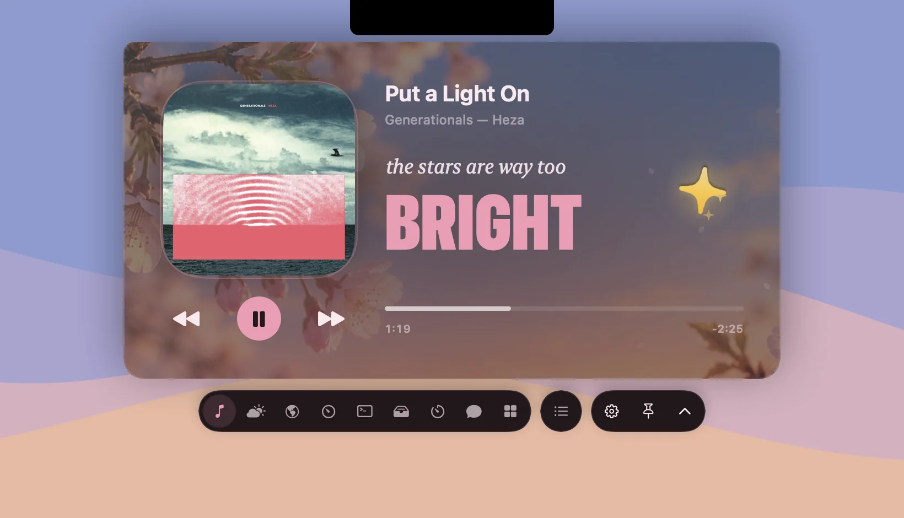

MacSpaces is a free, open-source menu-bar app that turns the notch into a small
workspace. Move the pointer to the notch and the **Nook** opens: change the song,
join your next call, start a timer, jot a note, park a file or check on a coding
agent. Move away and it tucks back in. Displays without a camera notch get a small
synthetic one, so it works on any Mac and any display.

[Requirements](#requirements) · [Install](#install) · [The Nook](#the-nook) ·
[Pages](#pages) · [Home Widgets](#home-widgets) · [The Closed Notch](#the-closed-notch) ·
[Clipboard History](#clipboard-history) · [Files](#files) · [Themes](#themes) ·
[Settings](#settings) · [Privacy](#privacy) · [Uninstall](#uninstall) ·
[Build From Source](#build-from-source)

## Requirements

- **macOS:** 13 Ventura or later (13 Ventura, 14 Sonoma, 15 Sequoia, 26 Tahoe and newer)
- **Mac:** Apple Silicon or Intel, one universal app
- **Display:** Any. A camera notch is used where there is one; other displays get a synthetic notch
- **Price:** Free and open source, no account

Everything works on macOS 13, with four exceptions that need **macOS 14 Sonoma or
later**:

- **Remove Background** for images in the Tray.
- **iPhone (Continuity Camera) and Desk View** as cameras in Mirror.
- The **arrow keys** in the Settings search results.
- The **arrow keys** in the Terminal command bar. On macOS 13, swipe up on the bar for earlier commands.

A few features use other apps. Meetings works with Zoom, or a Google Meet tab in your
browser, when their menus are in English. The coding panels read Claude Code and
Codex sessions if you use them. Messages features use the Messages app on your Mac.

## Install

**Download:** Get [MacSpaces.dmg](https://github.com/zlichtman/MacSpaces/releases/latest/download/MacSpaces.dmg)
(the current release is **3.15**), open it and drag **MacSpaces** into
**Applications**. It's signed with a Developer ID and notarized by Apple.

**Homebrew:**

```sh
brew install --cask zlichtman/tap/macspaces
```

This is the current cask for Apple Silicon and Intel Macs running macOS 13 or later.
Installing by the full name adds
[the tap](https://github.com/zlichtman/homebrew-tap) for you.

MacSpaces lives in the menu bar, with no Dock icon or window. Open it once after
installing:

```sh
open -a MacSpaces
```

**Updates are automatic.** MacSpaces checks GitHub about once an hour, downloads a
new version, checks its signature, version and that it runs on your Mac, and asks
before restarting. **Check for Updates** in the menu bar checks right away. If you
still have **MacSpaces 1.14**, it updates itself to the current version: there is
only one version now, for every Mac from macOS 13 on.

## The Nook

The Nook hangs just below the notch, with a **dock** under it. The dock opens full
**pages** on the left, shows controls for the page you're on in the middle (your Home
profiles, or Apple Music's playlist), and has Settings, Pin and Close on
the right. Choose and order your pages in **Settings → Notch → Apps** by dragging
their handles.

**Home** is a grid of widgets. Each widget is the small form of a page: click its
corner button, double-click it or right-click → **Open** and the page grows out of
the tile. Each widget has one fitted size: Music is wide, while the Clock and timers stay
compact. Drag previews from the widget gallery in Settings into Home or onto the Nook. Make several **Home profiles** (work,
music, focus) and switch between them from the dock, each with its own icon.

Hover and scrolling never open the Nook over Mission Control, and an open Nook steps
aside when Mission Control appears. **Hide in apps** keeps it out of the way in front
of apps you choose, such as a game or a presentation (**Settings → General**).

## Pages

<p>
  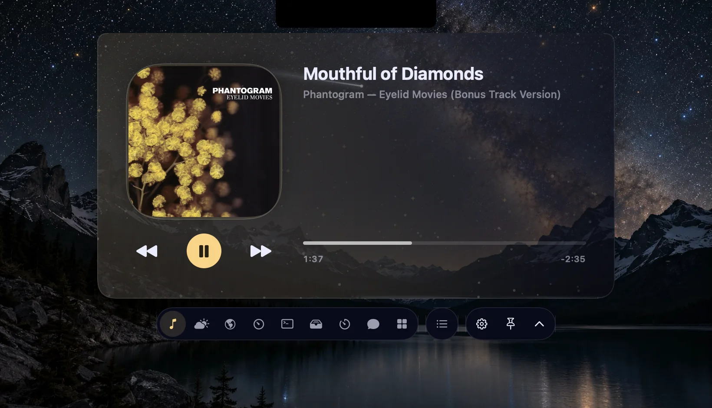
  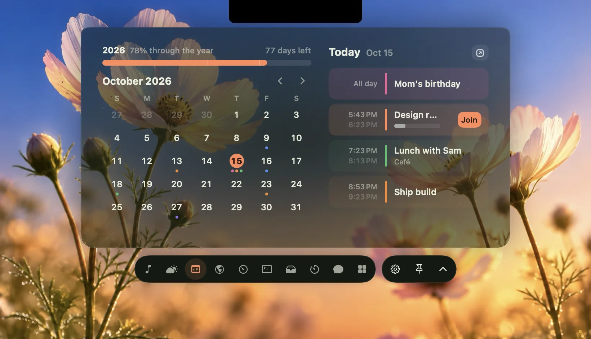
</p>
<p>
  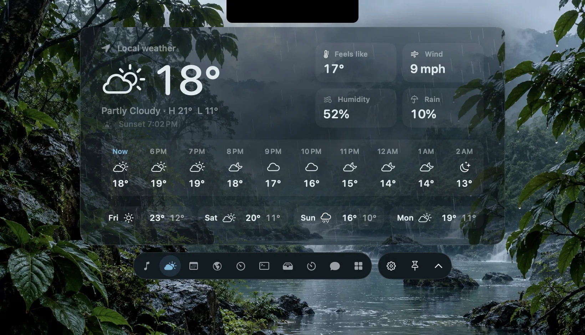
  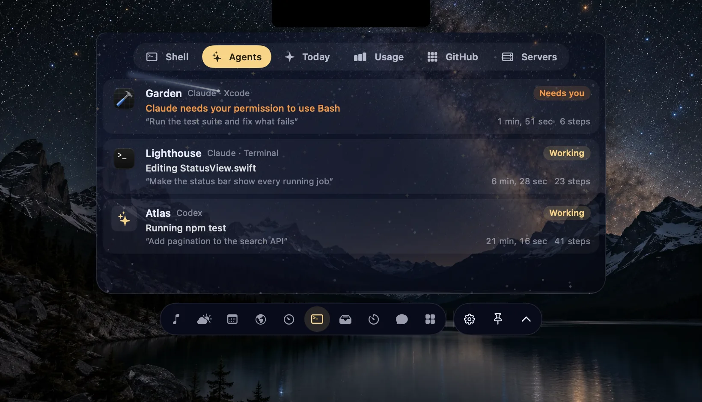
</p>
<p>
  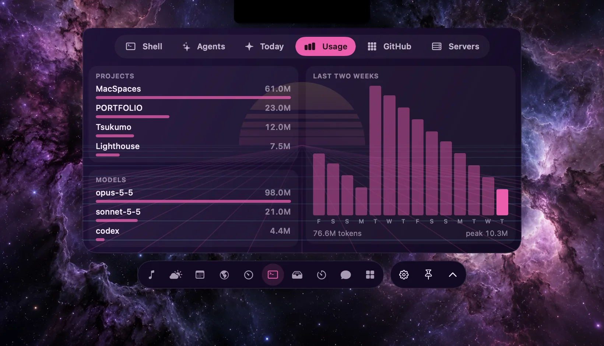
  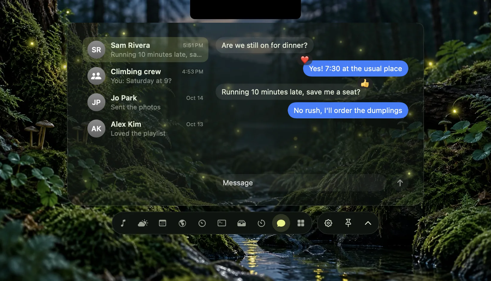
</p>
<p>
  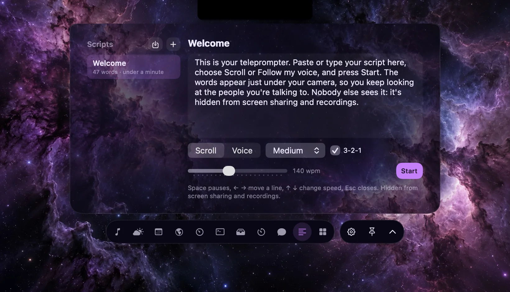
  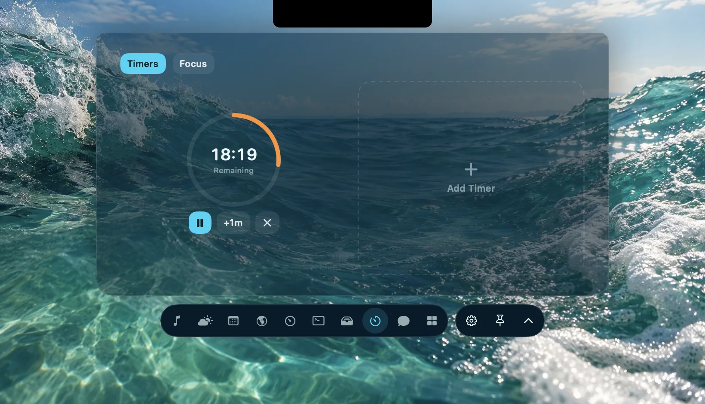
</p>
<p>
  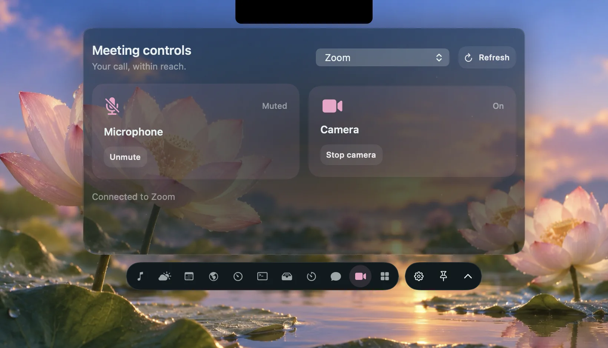
  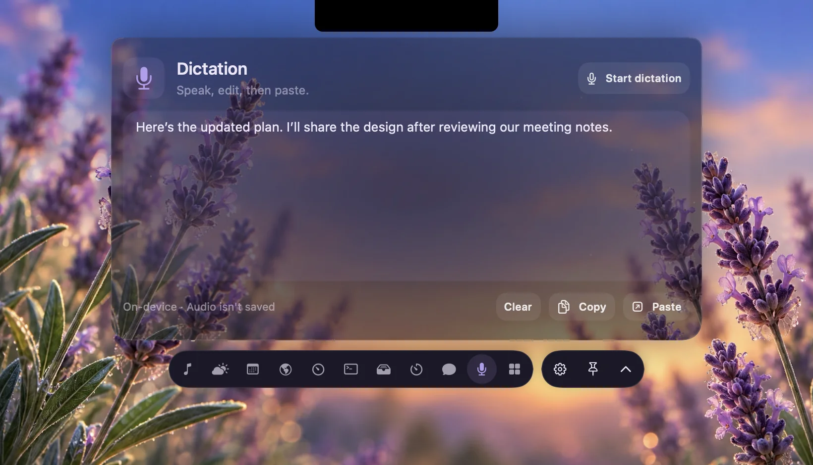
</p>
<p>
  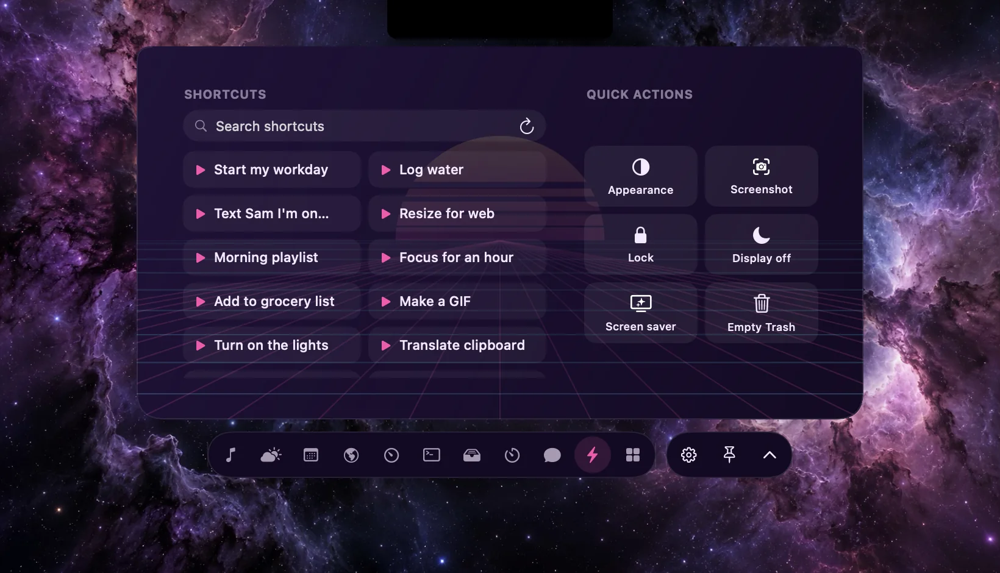
  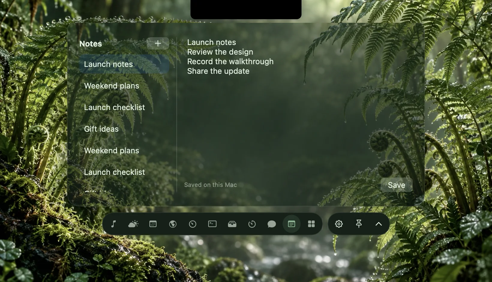
</p>

<p>
  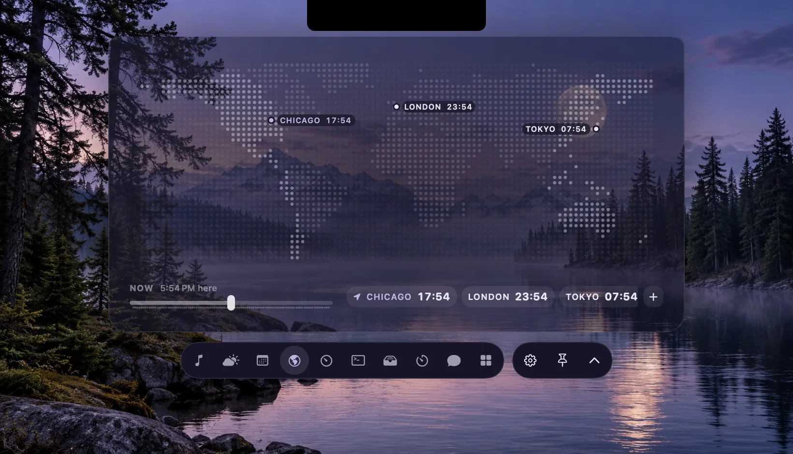
  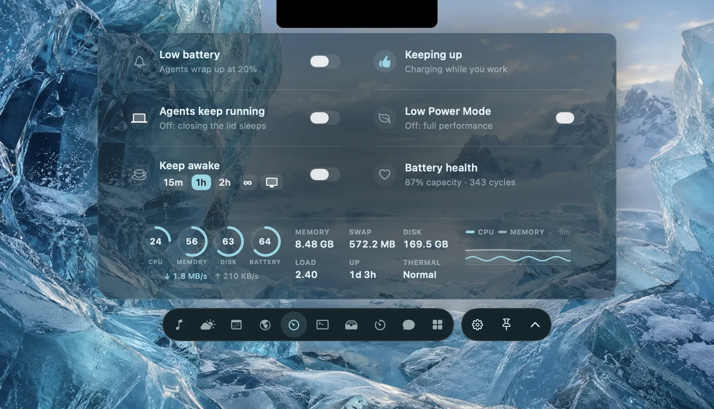
</p>

- **Music:** The cover (Spotify's own the moment the song changes, or looked up by
  artist and album when a player shares none), a slim seek bar and big controls,
  tinted by the album art. Lyrics stay in sync in one of six styles: **Classic**,
  **Poster** (the line's biggest word as a headline), **Choreography** (words step in),
  **Stickers** (Poster with a small animated scene when a line mentions something:
  over ninety of them, chosen by what the line means), **Karaoke** (the line fills as
  it's sung) and **Typewriter**. Lyrics work in any language, and words that LRCLIB
  blanks out are filled back in. Apple Music's playlist opens from the middle of the
  dock.
- **Calendar:** How far through the year you are, a month grid with coloured event
  dots, and your day with **Join** buttons for Zoom, Meet, Teams and other calls.
- **Weather:** Now, the next ten hours and the next four days, with feels-like, wind,
  humidity and rain. Units follow macOS. Recent forecasts are saved locally and
  restored across launches, while enabled dock data warms as you approach the notch.
- **Terminal:** A real shell for quick commands (type `brew upgrade`, press Return,
  move on), plus your coding day in tabs: **Agents** (every Claude Code and Codex
  session, what it's doing, and which one needs you; click one to jump to its app;
  turn it on in **Settings → Activities → Coding Agents That Need You**, which adds one silent hook
  and keeps yours),
  **Today**, **Usage** (tokens, Claude's five-hour window, Codex's plan limits, top
  projects and models), **GitHub** (your contribution graph and streaks) and
  **Servers** (local dev servers by port, to open or stop).
- **Messages:** Your conversations and the open thread, with reactions, photos and
  files, and a reply bar. New messages slide down under the notch with the sender's
  name and photo; reply right in the card.
- **Teleprompter:** Your scripts, just under the camera. It scrolls at your speed or
  follows your voice (recognised on your Mac only), and it's hidden from screen
  sharing and recordings. Import text, Markdown, RTF or Word files.
- **Timers:** Up to three side by side, each in its own colour.
- **Meetings:** Mute your microphone or turn off your camera in the current Zoom call
  or Google Meet tab.
- **Dictation:** Press Start, speak, edit the text, then Copy or Paste it into the app
  you were in. It stops when you leave the page and keeps no audio.
- **Shortcuts:** Search and run any of your Shortcuts, with six quick actions such as
  Lock and Screen saver.
- **Clock:** A world map of your places and their times; click anywhere on it to add
  that place to your bar.
- **System:** Detailed stats; **Overtime**; whether your charger keeps up (a thumbs up
  or down), Low Power Mode, battery health and your devices' batteries; and a big battery
  across the bottom with the time to full or the time left.
- **Notes, Reminders, Clipboard**, **Mirror**
  (a camera preview that runs only while it shows, reuses its session between visits
  and configures the camera off the UI thread) and **Tray** (below).

**Find Action.** Press **⌃⌥ Space** (change it in **Settings → General**) to search
every page, tool and action by name and run it. Pages opened from the keyboard stay
open until you close them. MacSpaces actions are also in the **Shortcuts** app.

## Home Widgets

- **Music:** The Music page in miniature, without lyrics.
- **Calendar:** Your current or next event, with a Join button.
- **Reminders:** Check them off in the tile.
- **Timer:** Custom lengths, pause and +1 minute. **Focus Timer:** Your own focus and
  break lengths, and a moon button that turns on Do Not Disturb while you focus
  (after a one-time Shortcuts setup, since macOS lets apps change Focus only that way).
- **Clock:** Your time and up to six places, in a Regular style, a Dot style like
  a split-flap departures board, or a Map style: a dot map of the world with night
  shaded and your places pinned. Click the map to drop a pin and see the time there.
- **Weather:** Current conditions in °C or °F; open its page for the full forecast.
- **Clipboard:** Recent clips and the paste queue.
- **Terminal**, **Notes**, **Messages**, **Shortcuts** and **Mirror:** The same as their
  pages.
- **System Stats:** CPU, memory and disk at a glance; the System page adds network,
  swap, free space, load, uptime and temperature.
- **Battery:** Your Mac's battery icon and level, plus macOS's own time to full while
  charging. Click it for maximum capacity and cycles as System Information reports them,
  temperature, your Bluetooth devices and Low Power Mode. It
  warns when the battery runs low, or when it keeps draining while plugged in because the
  charger can't keep up.
- **Keep Awake:** For 15 minutes, an hour, two hours, or until you stop it.
- **Quick Actions:** Labelled buttons such as Lock and Display off.
- **Calculator:** Sums, units and currencies as you type (`15% of 80`, `5 km in mi`,
  `100 usd to eur`); click the answer to copy it.
- **Dev Servers:** Your local servers by port and project.

Click a tile to select it, press Delete to remove it and ⌘Z to put it back.
**Settings → Notch → Home** draws your Home layout to scale.

## The Closed Notch

While the Nook is closed, the space beside the camera shows what's going on:

- **Music:** Moving sound bars in your theme's colours (still with Reduce Motion).
- **Timers:** Every running timer, soonest first, in its colour.
- **Meetings:** A countdown from ten minutes before a video call.
- **Paste Queue:** How many clips are left (never what they say).
- **New Screenshots**, when you send them to the Tray.

**Notifications Through the Notch.** A new message opens the Nook on that
conversation, and an agent that needs you opens the Agents tab; either closes after
a few seconds unless you move in. Other notifications can slide down as cards under
the camera, sized to what they say (**Settings → Activities → Under the Notch**). Cards
never appear in screen sharing or recordings, or while your Mac is locked.

**Overtime: Keep Coding Agents Going.** The System page's Overtime card has three
switches. **Low battery:** when your Mac is on battery at 20% or below, running Claude
Code and Codex sessions are told to save and commit their work and hold off on long
jobs (turning it off removes the hook again). **Agents keep running:** your Mac and its
agents keep working with the lid closed. Click **Skip the password** and allow MacSpaces once in
System Settings → General → Login Items, and it switches without asking; otherwise macOS asks for
your administrator password each time. It turns itself off on battery at 20% and when MacSpaces quits. **Keep awake:** for 15
minutes, an hour, two hours, or until you stop it, with or without the display.

## Clipboard History

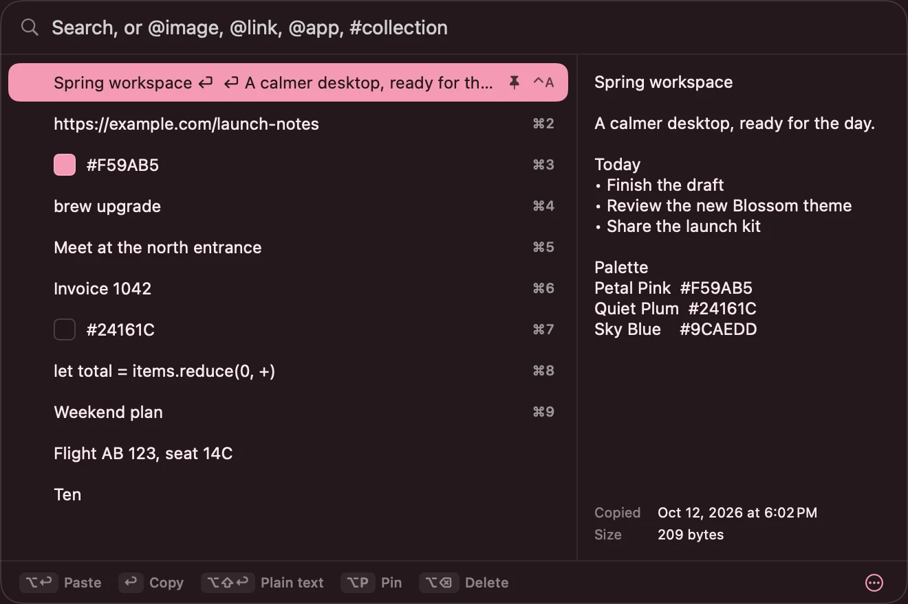

Press **⇧⌘C** in any app for everything you've copied, at the pointer. Type to search
(exact, fuzzy or regular expression; text inside images is recognised on your Mac),
↑↓ to choose, ↩ to copy, ⌥↩ to paste into the app you were in, ⌥⇧↩ to paste as plain
text, ⌘1–9 / ⌥1–9 for the first nine, ⌥P to pin and ⌥⌫ to delete. Narrow the list
with `@image`, `@link`, `@file`, `@color`, `@pinned`, `@snippet`, `@` and an app's
name, or `#` and a collection. Right-click a clip to copy it in another case, pin it
or file it in a collection; drag clips into other apps. Keep **snippets** for text
you paste often and **pick a colour** from anywhere on screen.

**Paste Queue.** Turn it on, copy several things, then press ⌘V again and again: each
paste is the next clip, in order or newest first.

**Settings → Clipboard** sets the shortcut, history size (up to 1,000), sorting, what's
ignored (apps, patterns, formats) and when unused clips delete themselves.
**Switching from Maccy?** Import its history and pins in one click.

## Files

<p>
  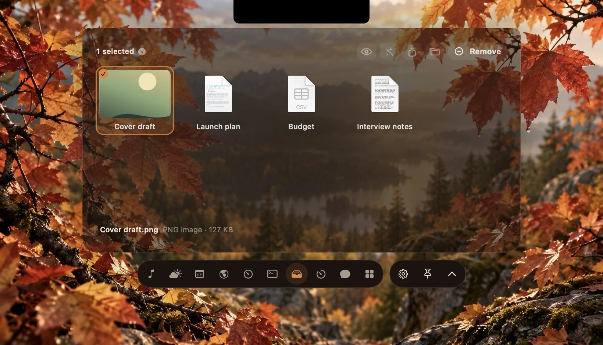
  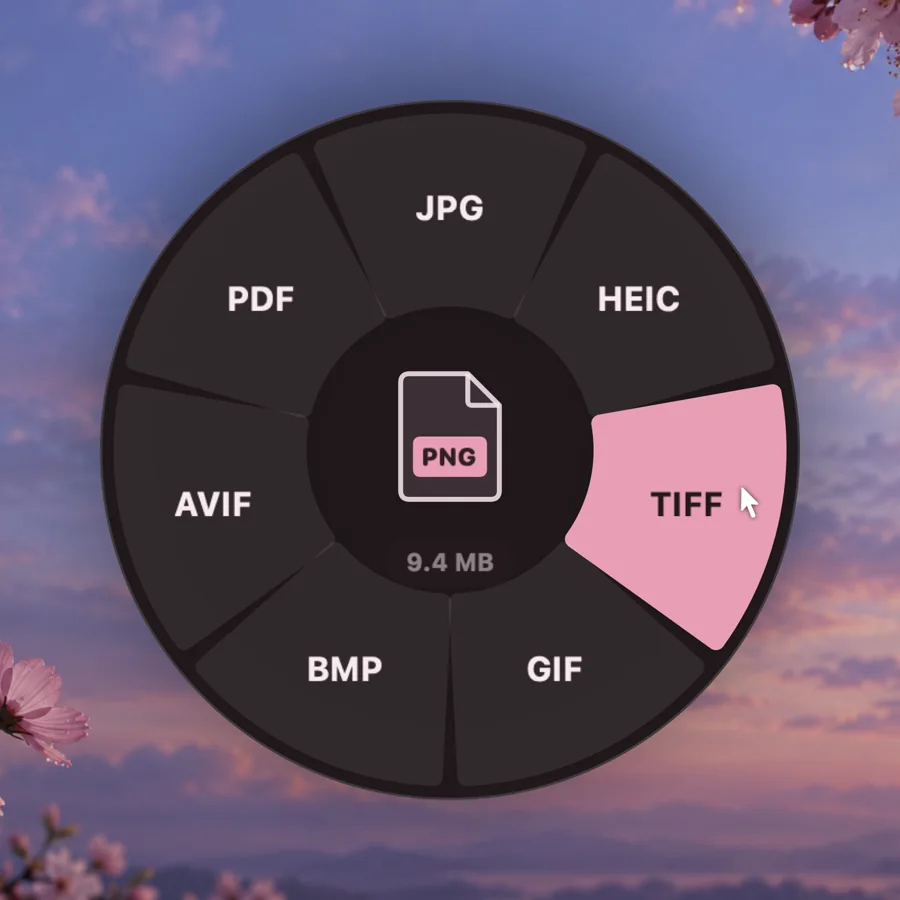
</p>

- **Tray:** Drag files to the notch and pause, and the Tray opens to hold them. Select
  several, preview with Space, drag them out, AirDrop one or all, paste in files,
  text, images or links, and undo a removal. Image and PDF files have **Copy Text**,
  and images have **Remove Background** (macOS 14+). Finder's Services menu has
  **Add to MacSpaces Tray**.
- **File Converter:** Drag a file and hold **Shift** for a wheel of formats around the
  pointer; drop on one and a converted copy is saved beside the original. Hold
  **⌥⇧** for tools instead: compress, remove metadata, resize, extract audio, make a
  GIF or a snapshot, shrink an image to **under 1 MB**, split or merge PDFs, zip and
  unzip. It handles images, PDFs, documents, video and audio, several at once, on
  your Mac.
- **File Tools:** The same tools for batches, with saved presets, a result for every
  file and a Cancel button, also from Finder and Shortcuts. **Settings → Files** can
  watch a folder, such as Downloads, for files that finish arriving.
- **File Baskets** (menu bar → **File Baskets**): Frosted circles you park anywhere,
  say beside the Dock. Drop files on one, click to open it, drag to move it. Baskets
  hold references, so your files stay where they are.
- **Screenshots in the Tray** (**Settings → Files**): Each new screenshot waits in
  the Tray, ready to drag, AirDrop or copy.

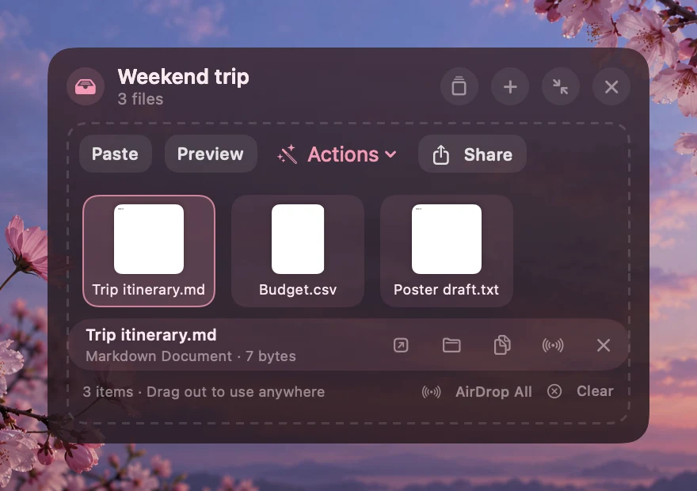

## Themes

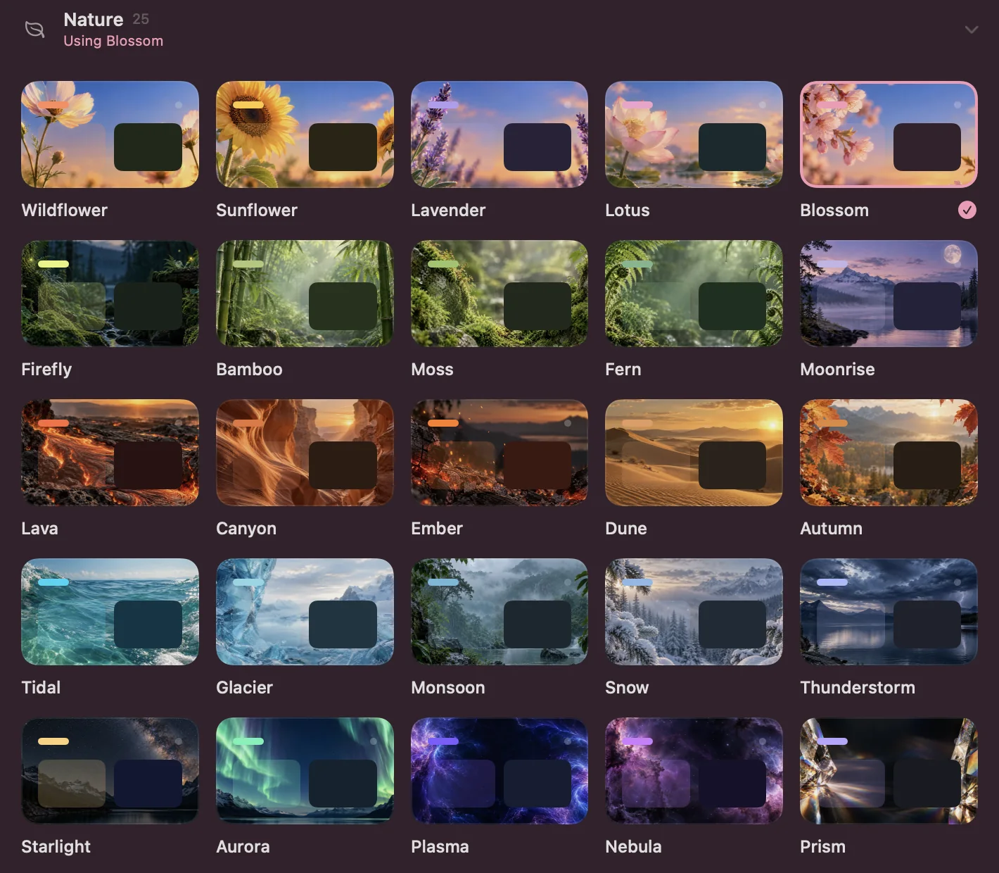

Sixty-five themes in five groups: **Core** (the MacSpaces app themes), **Terminal**
(classic editor palettes such as Nord, Catppuccin and Tokyo Night, single colours
from Ruby to Turquoise, and **Custom**, where you pick your own background and accent),
two groups of scenes that move gently behind the Nook, **Nature** (flowers, forests, earth,
water and sky) and **Tech**, and **Glass** (see-through panes over your desktop). Each theme has light and dark versions
that follow your system or stay fixed. Effects move only while the Nook is open and
never with Reduce Motion. The five flower
themes use detailed botanical images with a subtle breeze and drifting pollen
(petals in Blossom, water ripples in Lotus). Earth and Water themes also use detailed
scenery: windblown sand in Dune, warm sparks in Ember and Lava, drifting autumn leaves, ocean ripples, rain and lightning,
snowfall and ice glints. Forest and Sky scenes add detailed foliage, moonlight and
celestial imagery with fireflies, mist, twinkling stars and flowing aurora. Rainbow
uses a flowing spectral current. Aurora and Prism keep their detailed photographic
scenes; Starlight pairs its night sky with twinkling and shooting stars. Theme cards show still
previews, and Glass previews share the live pane’s top-edge highlight.

## Settings

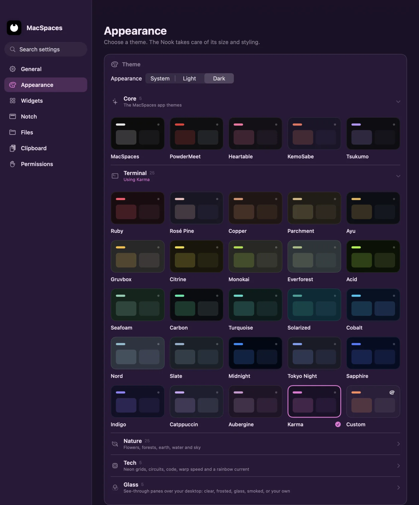

The sidebar has three sections. **Core**: **General** (startup, displays, opening and
closing, keyboard, updates and the installed version), **Appearance** (light or dark,
themes, lyric styles and motion) and **Permissions** (each permission's status, with a
button to allow it or open System Settings). **Notch**: **Home** (profiles and the Home
layout), **Apps** (dock apps and controls) and **Activities** (everything shown beside and under the
notch). **Tools**: **Files** (screenshots, downloads and the File Converter) and
**Clipboard**. Press **⌘F** to find any setting.

## Privacy

MacSpaces has no account, no analytics and no ads. A feature asks for access only
when you turn it on:

| Permission | Used By |
| --- | --- |
| Camera | Mirror |
| Location | Weather (otherwise an approximate location from your IP address) |
| Calendars, Reminders | Their widgets and the meeting countdown |
| Contacts | Names and photos for Messages |
| Bluetooth | The Battery widget and connecting paired audio devices |
| Automation | Media details, Quick Actions and Messages replies |
| Accessibility | Meetings controls, the paste queue and pasting from clipboard history (to see and send ⌘V) |
| Microphone, Speech Recognition | Dictation, and the teleprompter in voice mode (recognised on your Mac) |
| Full Disk Access | The Messages page and notifications through the notch (read-only) |

Clipboard history stays in memory unless you choose to keep it. Anything MacSpaces
saves about you (kept history, pins and snippets, teleprompter scripts) is encrypted
with a key held in your Mac's Secure Enclave, or in the login keychain on Macs
without one. Copies that password managers mark as concealed, and text shaped like a
credential (private keys, access tokens, card numbers, `.env` secrets), are never
recorded. MacSpaces never writes to your Messages, and it sends a reply only to the
conversation you're in.

The app contacts only the services its features use: Open-Meteo and ipapi.co for
weather; LRCLIB and lyrics.ovh for lyrics; Spotify, Apple's iTunes Search and Deezer
for album covers a player doesn't share (only the artist and album or title are
sent); the European Central Bank's rates (frankfurter.app) when you convert a
currency; GitHub's public contribution calendar for the GitHub tab; and GitHub for
updates.

## Uninstall

Quit MacSpaces from the menu bar and move it to the Trash, or run
`brew uninstall --cask macspaces`. First turn off **Coding agents that need you**
(Settings → Activities) and **Low battery** (the System page) if you use them, so their hooks are
removed, and choose **Remove Helper** from the **Agents keep running** row's menu if you
allowed it. Settings are in
`~/Library/Preferences/dev.opensource.MacSpaces.plist` and saved data in
`~/Library/Application Support/MacSpaces`; delete them for a clean slate.

## Build From Source

Install Xcode 26 or later and [XcodeGen](https://github.com/yonaskolb/XcodeGen), then:

```sh
git clone https://github.com/zlichtman/MacSpaces.git
cd MacSpaces
make
```

The build targets macOS 13 and later, for Apple Silicon and Intel. The
[engineering guide](AGENTS.md) covers architecture, checks and releases, and the
[changelog](CHANGELOG.md) records each version.

## Contribute

[Open an issue](https://github.com/zlichtman/MacSpaces/issues) with your macOS
version, your MacSpaces version (**Settings → General**) and the steps that cause the
problem. Pull requests are welcome.

## Credits

The calendar's year progress bar and month grid follow Aaron Lichtman's DayDrop
menu-bar calendar. The Terminal uses [SwiftTerm](https://github.com/migueldeicaza/SwiftTerm)
(MIT License, see [Acknowledgements](Sources/Resources/Acknowledgements.txt)).
MacSpaces is free and open source under the [MIT License](LICENSE).
